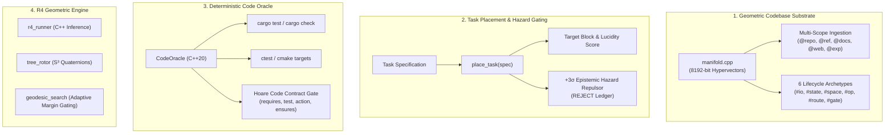

# R4 Coding Engine & Manifold Substrate

A high-performance geometric substrate, lifecycle router, and deterministic code oracle derived from [uor-r4](https://github.com/Syntra-Labs/uor-r4) and [synvim](https://github.com/Syntra-Labs/synvim), focused on codebase understanding, architectural task placement, and test-driven code contract verification.

## Architecture



## Quick Start

### Build & Run Tests (C++20)

```bash
mkdir -p build && cd build
cmake ..
make -j$(nproc)
ctest --output-on-failure
```

### Manifold CLI

```bash
# Run self-tests
./build/my_bin/manifold selftest

# Ingest a repository into an .mfd binary checkpoint
./build/my_bin/manifold ingest my_repo.mfd --scope repo src/

# Scoped query across archetypes and modalities
./build/my_bin/manifold query my_repo.mfd "@repo #io tokenizer"

# Semantic task placement & hazard alert check
./build/my_bin/manifold place my_repo.mfd "Refactor buffer ingestion in tokenizer"
```

### Deterministic Code Oracle

```cpp
#include "oracle/code_oracle.hpp"

syn::HoareContract contract;
contract.id = "lexer-token-stream";
contract.test_command = "cargo test -p my-crate -- test_token_stream";
contract.action_desc = "Implement token stream parser";
contract.ensures_spec = "Emits EOF token cleanly without panics";

syn::CodeExecutionResult result;
bool ok = syn::CodeOracle::verify_contract(contract, result);
assert(ok && result.success);
```

## Alignment with Upstream UOR-R4

This repository prepares contributions for the upstream [UOR-Foundation/uor-r4](https://github.com/UOR-Foundation/uor-r4) project, specifically targeting:
- **Milestone M6 (Reasoning & Coding, Issue #2034)**: Providing the deterministic compilation and test execution oracle (`cargo test`, exact outputs).
- **Object Store / Router**: Extending `uor-r4-object-store::manifold_sketch` with full lifecycle archetype classification (`#io`..`#gate`), multi-scope routing, and $+3\sigma$ epistemic hazard detection.
