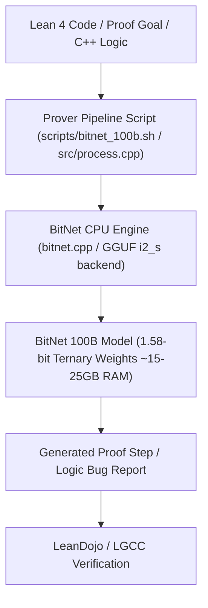

# Implementation Plan: Testing Microsoft BitNet 100B CPU Model in Prover Pipeline

**Task:** Taskwarrior `#24` (`project:prover`) — *test the pipeline with Microsoft's new BitNet 100B parameter model that runs on CPU*  
**Repository:** [prover](file:///home/yassine/code/prover)  

---

## 🎯 Goal & Objectives

Integrate and benchmark Microsoft's **BitNet 100B** (1.58-bit quantized LLM) into the `prover` inference and verification pipeline running locally on CPU. 

* **Target Output:** Evaluate whether BitNet 100B provides superior logical reasoning and theorem proving capabilities compared to existing 7B models (`deepseek-prover-v2-7b`, `qwen2.5-coder-7b`), while maintaining acceptable generation latency on multi-core CPU.
* **Key Constraint:** Pure CPU execution leveraging BitNet's 1.58-bit ternary weight SIMD kernels (AVX-512 / AVX2 / ARM NEON).

---

## 🏗️ Execution Architecture

---

## 📋 Task Breakdown

### Phase 1: BitNet CPU Runtime & Dependencies Setup
- [ ] Check CPU capability (`lscpu` for AVX2, AVX-512, AMX, or vector extensions).
- [ ] Clone and build `BitNet.cpp` / BitNet inference runtime (or update `vendor/llama.cpp` if 1.58-bit kernel integration is present).
- [ ] Configure build flags optimized for target CPU architecture (`-march=native`, OpenMP threading).

### Phase 2: Model Acquisition & Asset Verification
- [ ] Download Microsoft BitNet 100B model weights from HuggingFace / official release repository.
- [ ] Verify model weight quantization format (`i2_s` / `TL2` / GGUF).
- [ ] Confirm system RAM headroom (estimated ~18-28 GB required for 100B 1.58-bit weights + context KV cache).

### Phase 3: Pipeline Integration
- [ ] Create `scripts/bitnet_100b.sh` wrapper script mirroring existing `scripts/prover.sh` and `scripts/qwen.sh`.
- [ ] Add support for `prover` system prompts ([docs/sys_prompt.txt](file:///home/yassine/code/prover/docs/sys_prompt.txt)) and LeanDojo prompt formatting.
- [ ] Implement output parser compatibility for single-line error detection and theorem generation (`src/parseJsonl.cpp` / `src/process.cpp`).

### Phase 4: Benchmarking & Performance Profiling
- [ ] **Sanity Test:** Execute single-statement inference with `bitnet_100b.sh`.
- [ ] **Theorem Proving Benchmark:** Test Lean 4 tactic generation via [src/testLeanDojo.py](file:///home/yassine/code/prover/src/testLeanDojo.py) on [vendor/benchsets](file:///home/yassine/code/prover/vendor/benchsets).
- [ ] **Performance Profile:** Measure:
  - Tokens per second (t/s) prompt processing and generation speed.
  - Thread scaling efficiency (`-t 4`, `-t 8`, `-t 16`).
  - Memory consumption (Peak RAM usage).

### Phase 5: Synthesis & Decision Matrix
- [ ] Compare pass-rate and proof accuracy vs `deepseek-prover-v2-7b`.
- [ ] Record benchmark log and document conclusions in `docs/bitnet_100b_results.md`.
- [ ] Update Taskwarrior status (`task 24 done`).

---

## ⚠️ Potential Risks & Mitigations

> [!IMPORTANT]
> **RAM Capacity Check:** 100B parameter 1.58-bit models require ~20GB+ RAM. Ensure system swap and available memory are verified prior to loading model weights.

> [!NOTE]
> **Thread Pinning:** Optimal performance on multi-core CPUs requires tuning thread counts (`-t`) to match physical core count (avoiding hyperthreading penalty).
